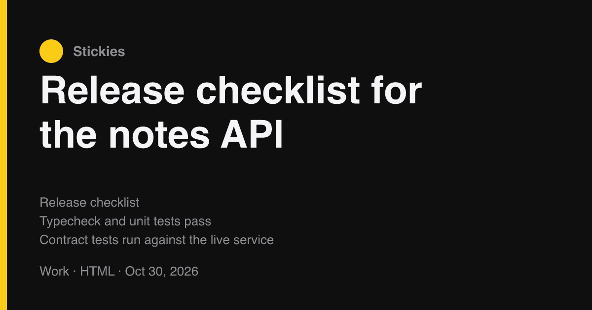
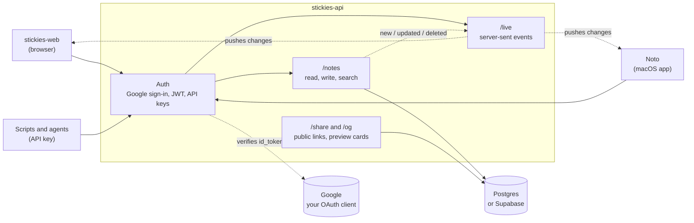

# stickies-api

The HTTP API behind Stickies: notes, folders, sharing and live updates, in 1 small Node service your own clients can talk to.



[](LICENSE)


## How it fits



Every client signs in the same way: Google sign-in, then the API issues a 15-minute access token and a 60-day refresh token. Scripts use an API key instead. When any client changes a note, the rest see it instantly over `/live`.

## Features

- **Notes and folders:** 13 read modes on 1 path, batch writes of up to 500, fuzzy folder matching
- **Live updates:** server-sent events, no Pusher or third-party realtime
- **Sharing:** public links, passcode-locked notes, 1200x630 link-preview cards
- **Safe keys:** no API key can delete a note, and no machine key can manage keys
- **Typed contract:** `openapi.yaml` for generated clients, with contract tests that catch drift
- **Small:** 6 runtime dependencies, no build step, Node runs the TypeScript directly

## Quick start

You bring 2 things: **your own database** and **your own Google sign-in**.

**1. Database: Postgres or Supabase.** Any Postgres 13+ works. Load the schema once:

```bash
psql "$DATABASE_URL" -f schema.sql
```

On Supabase, copy the connection string from **Project Settings > Database** and use it as `DATABASE_URL`.

**2. Google sign-in.** In [Google Cloud Console](https://console.cloud.google.com/apis/credentials), create an **OAuth client ID** (Web application). Copy its client ID and secret into `.env`, and set `OWNER_EMAIL` to the Google address allowed to sign in.

**3. Run it.**

```bash
git clone https://github.com/bunlongheng/stickies-api.git
cd stickies-api
npm install
cp .env.example .env     # fill in the values below
npm run dev              # http://localhost:4446
npm test
```

## Configuration

| Env var | Required | Purpose |
|---|---|---|
| `DATABASE_URL` | yes | Your Postgres or Supabase connection string |
| `AUTH_SECRET` | yes | Long random string that signs access and refresh tokens |
| `GOOGLE_CLIENT_ID`, `GOOGLE_CLIENT_SECRET` | yes | Your Google OAuth client |
| `OWNER_EMAIL` | yes | The only Google account allowed to sign in |
| `STICKIES_API_KEY` | no | Shared bearer token for scripts and agents |
| `CORS_ORIGINS` | no | Browser origins allowed to call the API |
| `DATABASE_CA_CERT` | prod | Postgres TLS certificate; production refuses to connect without it |

Optional integrations (AI, Philips Hue, GitHub backup) are listed in `.env.example`. Each one answers 503 until it is configured.

## Related repos

| Repo | What it is |
|---|---|
| [stickies-web](https://github.com/bunlongheng/stickies-web) | The web client: the whole board in the browser |
| [noto](https://github.com/bunlongheng/noto) | A fast macOS app onto every note, in Swift |
| [quick-stick-lite](https://github.com/bunlongheng/quick-stick-lite) | A sticky-note grid in 1 file, no build |


---

<div align="center">

<a href="https://bunlongheng.com"></a>
<a href="https://www.linkedin.com/in/bunlongheng/"></a>
<a href="https://www.instagram.com/ibunlong/"></a>
<a href="mailto:bheng.code@gmail.com"></a>

<br>

Built by **[Bunlong](https://bunlongheng.com)** &nbsp;·&nbsp; [more apps](https://bunlongheng.com/projects)

</div>
